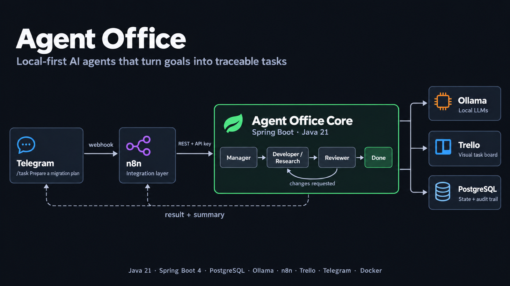
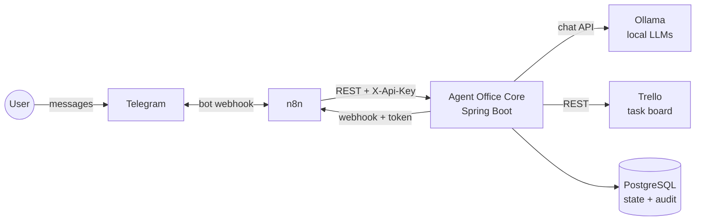
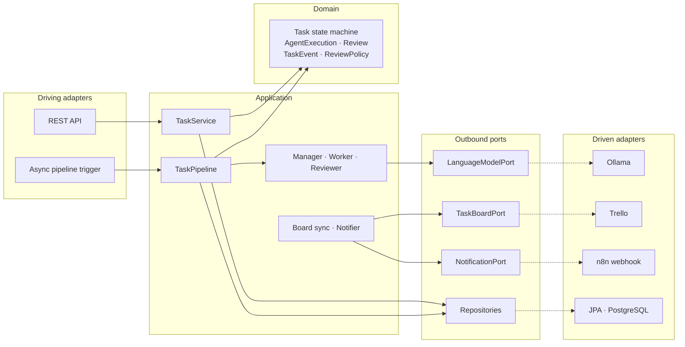
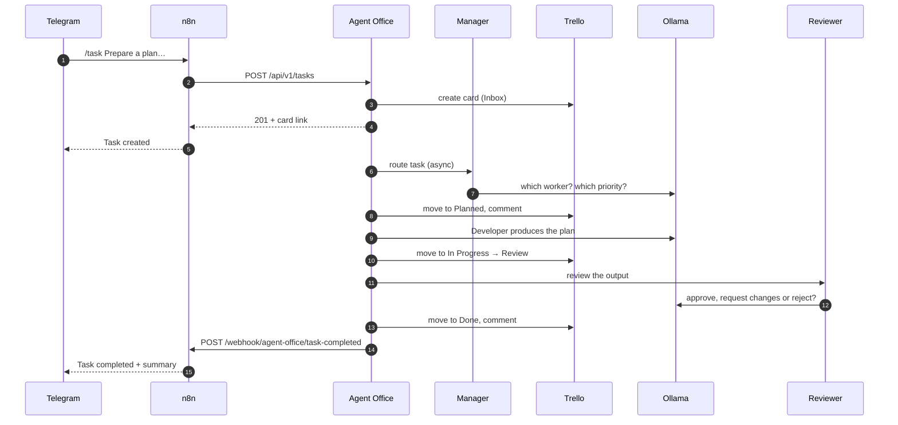
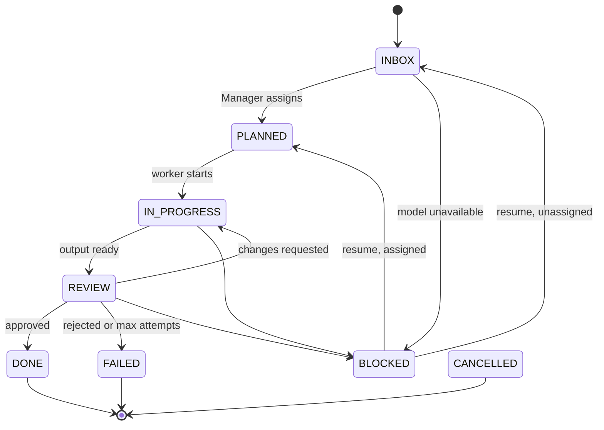

# Agent Office



Agent Office is a local-first AI agent workspace that turns user goals into traceable tasks, assigns them to specialized agents, coordinates execution and review, and exposes the workflow through Telegram and Trello.

This project is designed as both a practical personal automation system and a demonstration of backend architecture, AI orchestration and enterprise integration patterns.

## What is Agent Office?

You send a goal to a Telegram bot: *"Prepare a technical plan to migrate service X to Java 21"*. A **Manager** agent decides who should work on it, a **Developer** or **Research** agent produces the deliverable with a local model, and a **Reviewer** agent approves it or sends it back with feedback. A Trello card follows the task across the board, and the result comes back to the chat.

Every step is a record: which agent ran, with which model and prompt version, what it answered, what the reviewer said, and when each state change happened.

## Why this project exists

Most agent demos are a loop around an LLM call. Real systems need the boring parts: explicit state, bounded retries, failure handling, audit trails, idempotent integrations, security and tests. Agent Office is a small system built with those parts first, on top of local models so it can run on a laptop without sending data anywhere.

## Demo

```
Telegram  /task Prepare a technical plan to migrate service X to Java 21
   ↓
Trello    card appears in 📥 Inbox → 📋 Planned (Manager assigned DEVELOPER)
   ↓      → 🤖 In Progress (Developer working with qwen3:8b) → 👀 Review → ✅ Done
Telegram  ✅ Task completed · Agent: DEVELOPER · Review: APPROVED · Summary: …
```

The full flow takes about 40 seconds with `qwen3:8b` on Apple Silicon. The step-by-step recording script, including failure scenarios and an API-only variant, is in [docs/demo.md](docs/demo.md).

## Architecture



| Component | Responsibility |
|---|---|
| **Agent Office Core** | The brain: tasks, agents, lifecycle rules, retries, reviews, audit trail, integrations |
| **n8n** | Translation layer: Telegram commands in, notifications out. No business logic |
| **Ollama** | Local models behind a provider-agnostic port |
| **Trello** | Visual board that mirrors the tasks; never their source of truth |
| **PostgreSQL** | State and audit trail, schema managed by Flyway |

Inside the core, a pragmatic hexagonal layout keeps the rules independent of every external system:



```
com.lucapodesta.agentoffice
├── domain           plain Java: task, agent, execution, review, exception
├── application      agents, use cases (service), outbound ports (port.out), DTOs
└── infrastructure   web, security, persistence, ollama, prompt, trello, notification,
                     execution, observability, config
```

ArchUnit enforces the direction of dependencies and keeps `domain` free of Spring, JPA and Jackson.

## How it works



Creating a task returns immediately; the agents run in the background once the request commits. Model calls never hold a database transaction, and each step re-reads the task, so cancelling a task while a model is thinking simply stops the pipeline.

## Agents

| Agent | Role | Answers with |
|---|---|---|
| Manager | Routes each task to a worker and sets its priority. Never does the work | `agent`, `priority`, `reason` |
| Research | Analyses the information in the task and structures conclusions. No web access | `summary`, `content` |
| Developer | Produces technical deliverables: plans, proposals, snippets. Never touches a repository | `summary`, `content` |
| Reviewer | Judges the worker's output against the task | `verdict`, `feedback` |

Research and Developer share one implementation (`WorkerAgent`) and differ only in their prompt. Prompts live in [`src/main/resources/prompts`](src/main/resources/prompts) with a versioned front matter; the version and the model are stored with every execution.

Model output is never trusted blindly. Answers are parsed tolerantly (code fences, chatter, letter case) but validated strictly: the Manager cannot route to itself, a negative review needs feedback. An unusable answer is retried once, then the task fails with `INVALID_AGENT_OUTPUT`.

## Task lifecycle



- Transitions are enforced by the domain; anything else is rejected with `INVALID_TASK_STATE`. Any unfinished task can be `CANCELLED`.
- The worker ↔ reviewer loop is bounded: after 3 attempts the task fails with `MAX_RETRIES_EXCEEDED`.
- `BLOCKED` means infrastructure trouble and is resumable (`POST /api/v1/tasks/{id}/execute`, or `/retry` in Telegram); `FAILED` is final.
- With `requiresHumanApproval`, an approved task waits in `REVIEW` and the user is notified; the approve/reject commands are on the roadmap.
- Each agent call is an `AgentExecution`, each verdict a `Review`, and every step is appended to the `TaskEvent` audit trail.

## Integrations

### Telegram

The user-facing interface. Commands: `/task <description>`, `/tasks`, `/status <id>`, `/cancel <id>`, `/retry <id>`, `/help`. Only chats listed in `TELEGRAM_ALLOWED_CHAT_IDS` are served, so a leaked bot cannot spend your GPU. Agent Office itself never talks to Telegram; n8n does.

### Trello

One card per task, moved across `📥 Inbox → 📋 Planned → 🤖 In Progress → 👀 Review → ✅ Done` (plus `⛔ Blocked`) with a comment for each meaningful step. When the task is done, the approved deliverable is posted as a final **📄 Result** comment, so it can be read on the card; the description keeps only the summary. Failed and cancelled tasks end in Done with `[FAILED]` / `[CANCELLED]` in the title. Each sync renders the full current state, so a missed call is repaired by the next one; if Trello is down the task keeps going and `TRELLO_SYNC_FAILED` is recorded.

```bash
TRELLO_API_KEY=... TRELLO_TOKEN=... scripts/trello-setup.sh   # creates the board and prints the TRELLO_* lines for .env
```

The Inbox column is also a **durable entry point**. A card added there by hand, for example from the Trello mobile app while this machine is off for days, becomes a task the next time the system runs: n8n calls `POST /api/v1/board/sync` every minute, each unlinked card turns into a task on that same card, and the result is sent to `TELEGRAM_DEFAULT_CHAT_ID`. Telegram itself only keeps undelivered bot messages for 24 hours.

### Ollama

Agents depend on `LanguageModelPort`; `OllamaLanguageModelAdapter` is today's only implementation, and another provider would be one more adapter. Connection failures and 5xx responses are retried once, timeouts are not, and a missing model fails with `AGENT_NOT_AVAILABLE` plus the exact `ollama pull` command. Any model works; `qwen3:8b` is the default and one model can serve every agent.

### n8n

Two versioned workflows in [`n8n/`](n8n): Telegram intake and task-completed notification. Their logic lives in Code nodes that are unit-tested with Node. Setup, credentials and security: [docs/n8n.md](docs/n8n.md).

## Tech stack

Java 21 · Spring Boot 4.1 (Web MVC, Data JPA, Validation, Security, Actuator) · PostgreSQL 18 · Flyway · Ollama · n8n · Trello REST API · Telegram Bot API · springdoc-openapi · Micrometer · Docker Compose · JUnit 5 · Mockito · AssertJ · Testcontainers · WireMock · Awaitility · ArchUnit · JaCoCo · GitHub Actions

## Running locally

Requirements: Docker and [Ollama](https://ollama.com) on the host (recommended on macOS, where containers cannot use the GPU).

```bash
cp .env.example .env          # set AGENT_OFFICE_API_KEY at least
ollama pull qwen3:8b
docker compose up --build
```

| Service | URL |
|---|---|
| API docs | <http://localhost:8080/swagger-ui.html> |
| n8n | <http://localhost:5678> |
| PostgreSQL | `localhost:5433` |

Try it without Telegram or Trello:

```bash
curl -X POST localhost:8080/api/v1/tasks \
  -H "X-Api-Key: $AGENT_OFFICE_API_KEY" -H 'Content-Type: application/json' \
  -d '{"title": "Java 21 migration plan", "description": "Prepare a technical plan to migrate service X from Java 11 to Java 21"}'
```

Ollama in a container instead of on the host:

```bash
OLLAMA_BASE_URL_DOCKER=http://ollama:11434 docker compose --profile ollama up --build
docker compose exec ollama ollama pull qwen3:8b
```

For development, run only the database in Docker and the app from the IDE or Maven; the `local` profile reads the same `.env`:

```bash
docker compose up -d postgres
./mvnw spring-boot:run -Dspring-boot.run.profiles=local
```

## Configuration

Everything is configured through environment variables; [`.env.example`](.env.example) lists them all with safe placeholders. The real `.env` is git-ignored.

| Group | Variables |
|---|---|
| Database | `DB_URL`, `DB_USERNAME`, `DB_PASSWORD`, `POSTGRES_PORT` |
| API | `AGENT_OFFICE_API_KEY` (required), `AGENT_OFFICE_PORT`, `PIPELINE_AUTO_START` |
| Ollama | `OLLAMA_BASE_URL` (host runs), `OLLAMA_BASE_URL_DOCKER` (container), `OLLAMA_MODEL`, `OLLAMA_MODEL_{MANAGER,RESEARCH,DEVELOPER,REVIEWER}`, `OLLAMA_READ_TIMEOUT` |
| Trello | `TRELLO_ENABLED`, `TRELLO_API_KEY`, `TRELLO_TOKEN`, `TRELLO_BOARD_ID`, `TRELLO_LIST_{INBOX,PLANNED,IN_PROGRESS,REVIEW,BLOCKED,DONE}` |
| n8n / Telegram | `TELEGRAM_ALLOWED_CHAT_IDS`, `TELEGRAM_DEFAULT_CHAT_ID`, `N8N_WEBHOOK_URL`, `N8N_NOTIFICATIONS_ENABLED`, `N8N_TASK_COMPLETED_WEBHOOK_URL`, `N8N_WEBHOOK_TOKEN` |

Integrations are off until enabled, and enabled integrations fail fast at startup with the list of missing settings. Profiles: default (containers), `local` (host development), `test`.

## n8n workflows

| Workflow | Trigger | Does |
|---|---|---|
| [`telegram-task-intake.json`](n8n/telegram-task-intake.json) | Telegram message | Parse command → call the API → reply |
| [`task-completed-notification.json`](n8n/task-completed-notification.json) | Webhook from Agent Office | Format result, failure or block reason → send to the originating chat (or the owner's, for Trello tasks) |
| [`trello-sync.json`](n8n/trello-sync.json) | Every minute | Turn new cards in the Trello Inbox into tasks |

Credentials are never versioned. `n8n/credentials/credentials.example.json` has the right ids, so after filling in the secrets the workflows and credentials are imported and linked with two commands, described in [docs/n8n.md](docs/n8n.md).

## API

Interactive documentation with schemas, enums, errors and headers: <http://localhost:8080/swagger-ui.html> (OpenAPI at `/v3/api-docs`).

| Method | Path | Purpose |
|---|---|---|
| `POST` | `/api/v1/tasks` | Create a task (`201`, with `Location` and board link) |
| `GET` | `/api/v1/tasks/{id}` | Get a task |
| `GET` | `/api/v1/tasks?status=&agent=&priority=&source=&externalReference=&page=&size=` | List tasks, newest first |
| `POST` | `/api/v1/tasks/{id}/execute` | Run a waiting task or resume a blocked one (`202`) |
| `POST` | `/api/v1/tasks/{id}/cancel` | Cancel an unfinished task |
| `GET` | `/api/v1/tasks/{id}/executions` | Every agent call with model, prompt version and output |
| `GET` | `/api/v1/tasks/{id}/reviews` | Reviewer verdicts |
| `GET` | `/api/v1/tasks/{id}/events` | Audit trail |
| `POST` | `/api/v1/board/sync` | Turn new Trello Inbox cards into tasks (only with Trello enabled) |

All errors share one shape, with codes such as `TASK_NOT_FOUND`, `INVALID_TASK_STATE`, `VALIDATION_ERROR`, `UNAUTHORIZED` and `CONCURRENT_MODIFICATION`:

```json
{
  "code": "TASK_NOT_FOUND",
  "message": "Task 4f0c… was not found",
  "correlationId": "telegram-918273",
  "timestamp": "2026-10-22T10:00:00Z"
}
```

## Testing

```bash
./mvnw clean verify                # unit + integration tests, coverage gate
node --test n8n/test/*.test.mjs    # n8n workflow logic
```

| Kind | What it covers |
|---|---|
| Unit | State machine, review policy and retry limit, agents' output parsing, pipeline scenarios with in-memory fakes, board and notification rules |
| Adapters (WireMock) | Ollama, Trello and n8n: success, timeouts, 4xx, 5xx, unreadable responses, credentials never in URLs |
| Integration (Testcontainers) | Real PostgreSQL: Flyway, constraints, repositories, optimistic locking, REST API, security |
| End to end | A task is routed, worked, sent back once by the reviewer, redone and completed asynchronously; executions, reviews, audit trail, board sync, notification, metrics and correlation ids are checked |
| Architecture | ArchUnit layer rules |
| Real model (opt-in) | `OLLAMA_SMOKE_TEST=true ./mvnw verify -Dit.test=OllamaSmokeIT` runs the real prompts against a local Ollama |

JaCoCo merges unit and integration coverage and fails the build if any `domain` or `application` package drops below 80% (today: ~99% domain, ~95% application). [CI](.github/workflows/ci.yml) runs the Maven build, the n8n workflow tests and a Docker image build on every push and pull request; nothing is deployed.

## Observability

- **Correlation id:** every request gets an `X-Correlation-Id` (the caller's, or a generated one). It appears in every log line and error body, follows the task into the background pipeline and is sent to Ollama, Trello and n8n. Telegram messages arrive as `telegram-<update_id>`, so one message can be traced end to end.
- **Logs:** key-value style (`event=… taskId=… agent=…`); secrets and prompts are never logged. `LOGGING_STRUCTURED_FORMAT_CONSOLE=ecs` switches to JSON.
- **Audit trail:** `GET /api/v1/tasks/{id}/events`, including board and notification outcomes.
- **Actuator:** `/actuator/health` (liveness and readiness) and `/actuator/info` (build, Java) are public; `/actuator/metrics` requires the API key.

| Metric | Tags |
|---|---|
| `agent_office.llm.calls` (timer) | `agent`, `model`, `outcome` |
| `agent_office.llm.tokens` (summary) | `agent`, `model`, `direction` |
| `agent_office.task.events` (counter) | `type` |

## Security

- Secrets only come from the environment; the repository contains placeholders only (`.env.example`, `credentials.example.json`).
- The API requires `X-Api-Key` (Spring Security, stateless, constant-time comparison); health, info and docs are public.
- The n8n notification webhook requires `X-Agent-Office-Token`; the Telegram bot only serves allowed chats.
- Trello credentials travel in the `Authorization` header, never in URLs; configuration objects mask secrets in `toString()`.
- Incoming correlation ids are validated before reaching the logs; unexpected errors never expose internals.
- Task content is passed to models as tagged data, and model output is validated before it changes anything.
- The container runs as a non-root user.

## Architecture decisions

| ADR | Decision |
|---|---|
| [001](docs/adr/001-hexagonal-architecture.md) | Hexagonal architecture, pragmatically |
| [002](docs/adr/002-n8n-as-external-orchestrator.md) | n8n as the external orchestrator, not the brain |
| [003](docs/adr/003-ollama-model-abstraction.md) | Local models behind a provider-agnostic port |
| [004](docs/adr/004-trello-as-task-board.md) | Trello as a view of the tasks, not their source of truth |
| [005](docs/adr/005-agent-execution-model.md) | Tasks, executions and reviews as separate records |
| [006](docs/adr/006-spring-boot-4.md) | Spring Boot 4 instead of 3.x |
| [007](docs/adr/007-integrations-react-to-committed-events.md) | Integrations react to committed audit events |
| [008](docs/adr/008-trello-inbox-as-durable-intake.md) | The Trello inbox as a durable entry point |

## Trade-offs

- **One service.** Agents, pipeline and integrations live in one Spring Boot application. Simple to run and reason about; scaling agents separately would need a queue.
- **In-process events, no outbox.** Integrations react to committed events, but if the app stops between a commit and its listener, that notification is lost (the board heals on the next change). After a crash, a task stuck in `IN_PROGRESS` needs a manual look.
- **Board sync on the request thread.** Creating a task waits for the Trello card (bounded by a 5 s timeout) so the reply can include its link.
- **Telegram needs a public URL.** The n8n Telegram trigger uses webhooks, so a tunnel is required even in a local setup.
- **Small local models.** `qwen3:8b` is fast and private but a lenient reviewer; per-agent models are supported for when quality matters more than speed.
- **JSON mode, not schemas.** The model is asked for JSON and the answer is validated in code; schema-constrained output would reduce retries.
- **One API key.** Enough for a personal system behind n8n; multi-user access needs real identities.

## Roadmap

**V2**

- Human approval: `/approve` and `/reject` in Telegram and the API (the model and notifications already support it)
- Outbox table and startup recovery for in-flight tasks
- Schema-constrained model output and per-agent model tuning
- Scheduled tasks and multiple projects
- Agent statistics, token metrics and a small web dashboard
- Agent memory, documents and RAG; MCP tools
- GitHub, Slack and email integrations

**V3**

- Agents that open pull requests against real repositories
- Browser agents and long-running workflows
- Shared agent memory, multi-user accounts and role permissions

## About

Built by Luca Podesta, backend Java developer, as a personal automation tool and a portfolio project on backend architecture, integrations and local AI.
