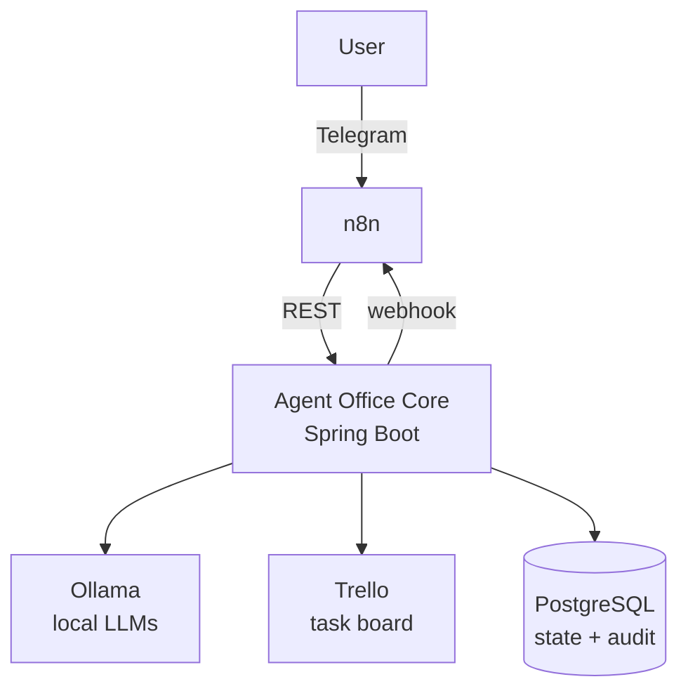
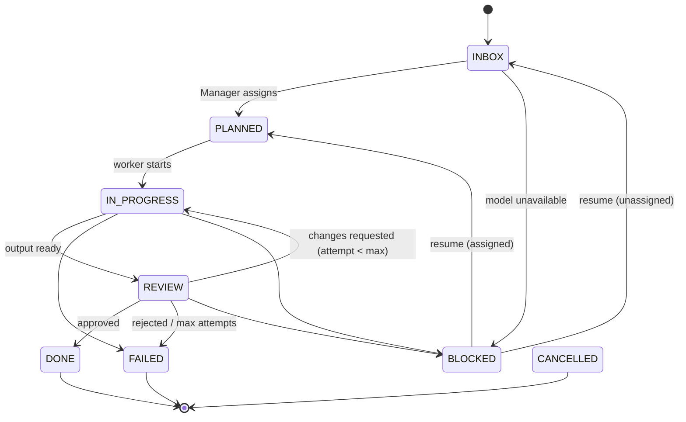

# Agent Office

Agent Office is a local-first AI agent workspace that turns user goals into traceable tasks, assigns them to specialized agents, coordinates execution and review, and exposes the workflow through Telegram and Trello.

This project is designed as both a practical personal automation system and a demonstration of backend architecture, AI orchestration and enterprise integration patterns.

> **Status:** early development — project skeleton in place. Domain, API and integrations are being built incrementally.

## Architecture



- **n8n** owns triggers and external workflows (Telegram intake, notifications, schedules).
- **Agent Office Core** owns the domain: tasks, agents, executions, reviews, state transitions and audit trail.
- **Ollama** provides local language models behind a provider-agnostic port.
- **Trello** is the visual board of the office.

The core follows a pragmatic hexagonal (ports & adapters) layout:

```
com.lucapodesta.agentoffice
├── domain          plain Java model and rules, no framework dependencies
├── application     use cases, inbound and outbound ports
└── infrastructure  adapters: REST, persistence, Ollama, Trello, n8n, config
```

## Agents

| Agent | Role | Answers with |
|---|---|---|
| Manager | Routes each task to a worker and sets its priority. Never does the work. | `agent`, `priority`, `reason` |
| Research | Analyses the information in the task and structures conclusions. No web access. | `summary`, `content` |
| Developer | Produces technical deliverables: plans, proposals, snippets. Never touches a repository. | `summary`, `content` |
| Reviewer | Judges the worker's output against the task. | `verdict`, `feedback` |

Research and Developer share one implementation (`WorkerAgent`) and differ only in their prompt. Model answers are parsed tolerantly (code fences and chatter are ignored) but validated strictly: an unusable answer is retried once, then the task fails with `INVALID_AGENT_OUTPUT`.

## How it works

Creating a task returns immediately. Once the request commits, the pipeline runs in the background:

1. **Manager** routes the task → `PLANNED`
2. **Worker** produces the deliverable → `IN_PROGRESS` → `REVIEW`
3. **Reviewer** decides:
   - `APPROVED` → `DONE` (or waits for a human if `requiresHumanApproval`)
   - `CHANGES_REQUESTED` → back to the worker with the feedback, up to 3 attempts
   - `REJECTED` → `FAILED`

If Ollama is unreachable the task goes to `BLOCKED`; `POST /api/v1/tasks/{id}/execute` resumes it. Model calls never hold a database transaction, and each step re-reads the task, so cancelling a task mid-run simply stops the pipeline.

## Task lifecycle

State changes are enforced by the domain; anything not drawn here is rejected with `INVALID_TASK_STATE`.



Any non-terminal task can also be `CANCELLED`. Each agent invocation is stored as an `AgentExecution`, each verdict as a `Review`, and every step is appended to the `TaskEvent` audit trail.

## Tech stack

Java 21 · Spring Boot 4 · Maven · PostgreSQL 18 · Flyway · Spring Data JPA · Docker Compose · JUnit 5 · Testcontainers

## Running locally

Requirements: Docker, and [Ollama](https://ollama.com) on the host (recommended on macOS, where containers cannot use the GPU).

```bash
cp .env.example .env          # set AGENT_OFFICE_API_KEY at least
ollama pull qwen3:8b
docker compose up --build
```

| Service | URL |
|---|---|
| Agent Office API | <http://localhost:8080/swagger-ui.html> |
| n8n | <http://localhost:5678> |
| PostgreSQL | `localhost:5433` |

Ollama inside Docker instead of on the host:

```bash
OLLAMA_BASE_URL_DOCKER=http://ollama:11434 docker compose --profile ollama up --build
docker compose exec ollama ollama pull qwen3:8b
```

Trello and Telegram are optional and off by default; see [Trello](#trello) and [docs/n8n.md](docs/n8n.md).

For development, run only the database in Docker and the app from the IDE or Maven (the `local` profile reads the same `.env`):

```bash
docker compose up -d postgres
./mvnw spring-boot:run -Dspring-boot.run.profiles=local
```

## Ollama

Agents never talk to Ollama directly: they depend on `LanguageModelPort`, and `OllamaLanguageModelAdapter` is the only implementation today. Another provider would be one more adapter.

```bash
ollama pull qwen3:8b
```

| Variable | Default | Purpose |
|---|---|---|
| `OLLAMA_BASE_URL` | `http://localhost:11434` | Use `http://host.docker.internal:11434` when the app runs in Docker and Ollama on the host |
| `OLLAMA_MODEL` | `qwen3:8b` | Model for every agent |
| `OLLAMA_MODEL_MANAGER`, `_RESEARCH`, `_DEVELOPER`, `_REVIEWER` | `OLLAMA_MODEL` | Per-agent override |
| `OLLAMA_READ_TIMEOUT` | `180s` | Max time to wait for one answer |

Connection failures and 5xx responses are retried once; timeouts are not, since the model already had its full budget. A missing model fails with `AGENT_NOT_AVAILABLE` and the exact `ollama pull` command.

System prompts live in [`src/main/resources/prompts`](src/main/resources/prompts), one file per agent. Each declares a `version` in its front matter, and that version is stored with every execution. All prompts ask for a JSON answer.

Opt-in check against a real Ollama (not part of CI):

```bash
OLLAMA_SMOKE_TEST=true ./mvnw verify -Dit.test=OllamaSmokeIT
```

## Trello

Trello is the visual office: one card per task, moved across `📥 Inbox → 📋 Planned → 🤖 In Progress → 👀 Review → ✅ Done` (plus `⛔ Blocked`) as the task progresses, with a comment for each meaningful step. Failed and cancelled tasks end in Done with `[FAILED]` / `[CANCELLED]` in the title.

The board mirrors the task; it never drives it. Each audit event triggers a sync after its transaction commits, and every update renders the full current state, so a missed call is repaired by the next one. If Trello is down the task keeps going and the problem is recorded as `TRELLO_SYNC_FAILED`.

Set up the board once (creates it with the six lists, or reads an existing one with `TRELLO_BOARD_ID`) and paste the output into `.env`:

```bash
TRELLO_API_KEY=... TRELLO_TOKEN=... scripts/trello-setup.sh
```

The integration is off unless `TRELLO_ENABLED=true`; credentials are sent in the `Authorization` header, never in URLs.

## Telegram and n8n

The user talks to a Telegram bot; n8n turns each command into an API call and sends finished tasks back to the
chat. n8n holds no business logic: it only translates between Telegram and the REST API.

| Command | What happens |
|---|---|
| `/task <description>` | Creates a task; the reply includes its id and Trello link |
| `/tasks`, `/status <id>` | Lists this chat's tasks / shows one |
| `/cancel <id>`, `/retry <id>` | Cancels a task / resumes a blocked one |

When a task finishes, fails or gets blocked, Agent Office calls an n8n webhook and the result arrives in the chat
that created it. Setup, credentials and security are described in [docs/n8n.md](docs/n8n.md).

## API

Interactive docs: <http://localhost:8080/swagger-ui.html> (OpenAPI JSON at `/v3/api-docs`).

| Method | Path | Purpose |
|---|---|---|
| `POST` | `/api/v1/tasks` | Create a task |
| `GET` | `/api/v1/tasks/{id}` | Get a task |
| `GET` | `/api/v1/tasks?status=&agent=&priority=&source=&externalReference=&page=&size=` | List tasks, newest first |
| `POST` | `/api/v1/tasks/{id}/execute` | Run a waiting task or resume a blocked one |
| `POST` | `/api/v1/tasks/{id}/cancel` | Cancel a non-finished task |
| `GET` | `/api/v1/tasks/{id}/executions` | Every agent invocation with model, prompt version and output |
| `GET` | `/api/v1/tasks/{id}/reviews` | Reviewer verdicts |
| `GET` | `/api/v1/tasks/{id}/events` | Audit trail |

All `/api/**` endpoints require the `X-Api-Key` header (`AGENT_OFFICE_API_KEY`); health, info and the API docs are public.

```bash
curl -X POST localhost:8080/api/v1/tasks \
  -H "X-Api-Key: $AGENT_OFFICE_API_KEY" \
  -H 'Content-Type: application/json' \
  -d '{"title": "Prepare Java migration proposal", "description": "Create a plan to migrate an application from Java 11 to Java 21"}'
```

Every response carries an `X-Correlation-Id` header (the caller's, or a generated one), which also appears in the logs. Errors share one shape:

```json
{
  "code": "TASK_NOT_FOUND",
  "message": "Task 4f0c... was not found",
  "correlationId": "3f6d2a7e-...",
  "timestamp": "2026-01-01T10:00:00Z"
}
```

## Testing

```bash
./mvnw clean verify                # unit + integration tests, coverage gate
node --test n8n/test/*.test.mjs    # n8n workflow logic
```

| Kind | What it covers |
|---|---|
| Unit (`*Test`) | State machine, review policy and retry limit, agents' output parsing, pipeline scenarios with in-memory fakes, board and notification rules |
| Adapters (WireMock) | Ollama, Trello and n8n: success, timeouts, 4xx, 5xx, unreadable responses, credentials never in URLs |
| Integration (`*IT`) | Real PostgreSQL via Testcontainers: Flyway, constraints, repositories, optimistic locking, REST API, security |
| End to end | A task created through the API is routed, worked, sent back once by the reviewer, redone and completed, asynchronously, with executions, reviews, audit trail, board sync and notification checked |
| Architecture | ArchUnit keeps `domain` free of Spring/JPA/Jackson and dependencies pointing inwards |

JaCoCo merges unit and integration coverage and fails the build if any `domain` or `application` package drops below 80% of instructions (currently ~99% domain, ~95% application).

An opt-in smoke test talks to a real Ollama with the real prompts: `OLLAMA_SMOKE_TEST=true ./mvnw verify -Dit.test=OllamaSmokeIT`.

CI ([`.github/workflows/ci.yml`](.github/workflows/ci.yml)) runs the Maven build with Testcontainers, the n8n workflow tests and a Docker image build on every push and pull request, and publishes a coverage summary. Nothing is deployed.

## Observability

- **Correlation id**: every request gets an `X-Correlation-Id` (the caller's, or a generated one). It is in every log line, in error bodies, follows the task into the background pipeline, and is sent to Ollama, Trello and n8n. Telegram messages arrive as `telegram-<update_id>`.
- **Logs**: `event=... taskId=... agent=...` key-value style; secrets and prompts are never logged. For JSON logs (ECS) set `LOGGING_STRUCTURED_FORMAT_CONSOLE=ecs`.
- **Audit trail**: `GET /api/v1/tasks/{id}/events` reconstructs what happened to a task, including board and notification outcomes.
- **Actuator**: `/actuator/health` (with liveness/readiness groups) and `/actuator/info` (build and Java version) are public; `/actuator/metrics` requires the API key.

| Metric | Tags |
|---|---|
| `agent_office.llm.calls` (timer) | `agent`, `model`, `outcome` (`success` or error code) |
| `agent_office.llm.tokens` (summary) | `agent`, `model`, `direction` (`prompt` / `output`) |
| `agent_office.task.events` (counter) | `type` (`TASK_COMPLETED`, `TASK_FAILED`, `TASK_BLOCKED`, `TRELLO_SYNC_FAILED`, …) |
