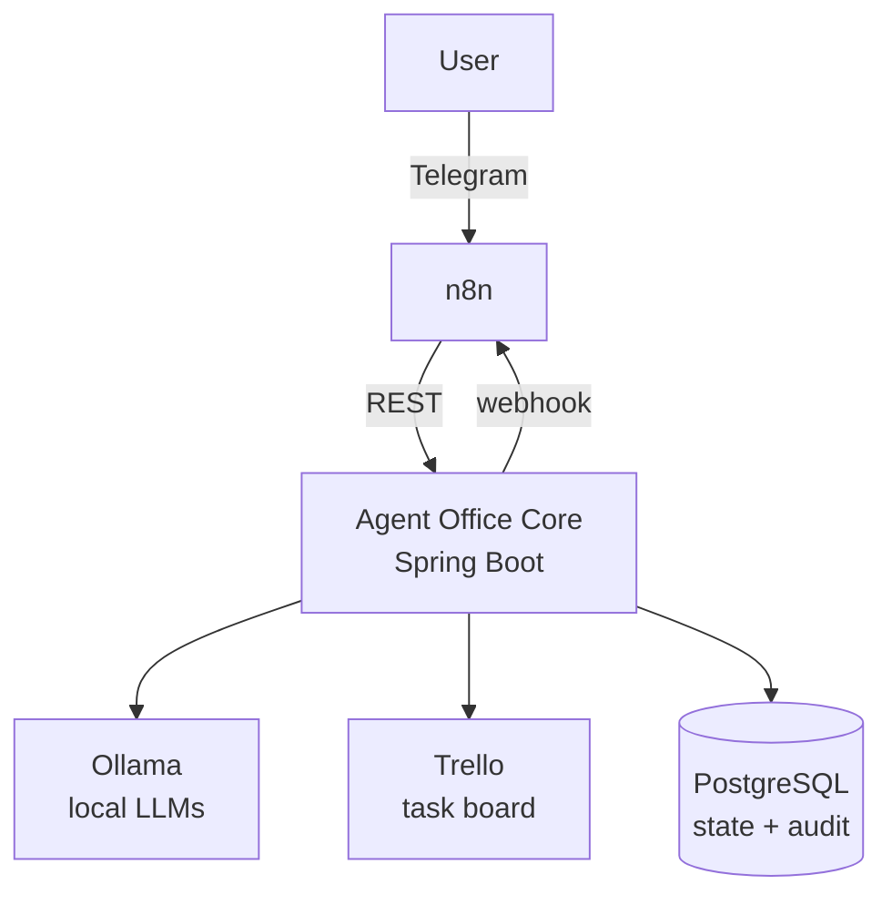

# Agent Office

Agent Office is a local-first AI agent workspace that turns user goals into traceable tasks, assigns them to specialized agents, coordinates execution and review, and exposes the workflow through Telegram and Trello.

This project is designed as both a practical personal automation system and a demonstration of backend architecture, AI orchestration and enterprise integration patterns.

> **Status:** early development — project skeleton in place. Domain, API and integrations are being built incrementally.

## Architecture



- **n8n** owns triggers and external workflows (Telegram intake, notifications, schedules).
- **Agent Office Core** owns the domain: tasks, agents, executions, reviews, state transitions and audit trail.
- **Ollama** provides local language models behind a provider-agnostic port.
- **Trello** is the visual board of the office.

The core follows a pragmatic hexagonal (ports & adapters) layout:

```
com.lucapodesta.agentoffice
├── domain          plain Java model and rules, no framework dependencies
├── application     use cases, inbound and outbound ports
└── infrastructure  adapters: REST, persistence, Ollama, Trello, n8n, config
```

## Tech stack

Java 21 · Spring Boot 4 · Maven · PostgreSQL 18 · Flyway · Spring Data JPA · Docker Compose · JUnit 5 · Testcontainers

## Running locally

Requirements: Java 21, Docker.

```bash
cp .env.example .env
docker compose up -d postgres
./mvnw spring-boot:run -Dspring-boot.run.profiles=local
```

The `local` profile reads the same `.env` as Docker Compose. PostgreSQL is published on host port `5433` by default (`POSTGRES_PORT`) to avoid clashing with a local installation; the app listens on `8080` (`SERVER_PORT`).

Health check: <http://localhost:8080/actuator/health>

## Testing

```bash
./mvnw clean verify
```

- `*Test` — unit tests (Surefire)
- `*IT` — integration tests against a real PostgreSQL via Testcontainers (Failsafe). Docker must be running.
