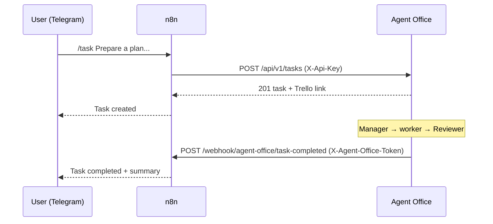

# n8n

n8n is the integration layer between the user and Agent Office. It owns the Telegram bot and
nothing else: no business rules, no task state. Every decision is made by the Spring Boot core.



## Workflows

| File | Trigger | What it does |
|---|---|---|
| [`telegram-task-intake.json`](../n8n/telegram-task-intake.json) | Telegram message | Parses the command, calls the Agent Office API, replies in the chat |
| [`task-completed-notification.json`](../n8n/task-completed-notification.json) | Webhook from Agent Office | Sends the result (or failure / block reason) back to the chat that created the task |

Bot commands:

| Command | API call |
|---|---|
| `/task <description>` | `POST /api/v1/tasks` with `source=TELEGRAM` and the chat id as `externalReference` |
| `/tasks` | `GET /api/v1/tasks?source=TELEGRAM&externalReference=<chat>` |
| `/status <taskId>` | `GET /api/v1/tasks/{id}` |
| `/cancel <taskId>` | `POST /api/v1/tasks/{id}/cancel` |
| `/retry <taskId>` | `POST /api/v1/tasks/{id}/execute` (resumes a blocked task) |
| `/start`, `/help` | Answered by n8n, no API call |

The logic of both workflows lives in their Code nodes and is tested without n8n:

```bash
node --test n8n/test/*.test.mjs
```

## Configuration

n8n reads these from its environment (Docker Compose passes them from `.env`):

| Variable | Purpose |
|---|---|
| `AGENT_OFFICE_API_URL` | Where n8n reaches Agent Office, e.g. `http://agent-office-core:8080` |
| `TELEGRAM_ALLOWED_CHAT_IDS` | Comma-separated chat ids allowed to use the bot. Empty means nobody, so a leaked bot cannot spend your GPU |
| `WEBHOOK_URL` | Public HTTPS URL of n8n (set from `N8N_WEBHOOK_URL`); Telegram can only deliver to HTTPS |
| `N8N_BLOCK_ENV_ACCESS_IN_NODE=false` | Lets the workflows read the variables above |

Agent Office side:

| Variable | Purpose |
|---|---|
| `AGENT_OFFICE_API_KEY` | Required by the API; the same value goes into the n8n credential *Agent Office API key* |
| `N8N_NOTIFICATIONS_ENABLED=true` | Turns on notifications |
| `N8N_TASK_COMPLETED_WEBHOOK_URL` | The production URL of the notification webhook |
| `N8N_WEBHOOK_TOKEN` | Shared secret; the same value goes into the n8n credential *Agent Office webhook token* |

## Setup

### 1. Create the Telegram bot

1. Talk to [@BotFather](https://t.me/BotFather), run `/newbot` and keep the token it gives you.
2. Send any message to your bot, then open `https://api.telegram.org/bot<token>/getUpdates` and note `message.chat.id`.
   Put it in `TELEGRAM_ALLOWED_CHAT_IDS`.

### 2. Expose n8n over HTTPS

Telegram pushes updates to a webhook, so n8n needs a public HTTPS URL even when everything else runs locally.
Any tunnel works, for example:

```bash
cloudflared tunnel --url http://localhost:5678
```

Set the printed `https://…` URL as `N8N_WEBHOOK_URL` and restart n8n. Quick tunnels change URL on every start;
a named tunnel or a fixed ngrok domain avoids re-activating the workflow each time.

### 3. Import credentials and workflows

Credentials are never versioned. Copy the template, fill in the three secrets, and import it together with the
workflows; the workflows reference the credentials by id, so they are linked automatically.

```bash
cp n8n/credentials/credentials.example.json n8n/credentials/credentials.json   # git-ignored
# edit credentials.json: bot token, AGENT_OFFICE_API_KEY, N8N_WEBHOOK_TOKEN
docker compose exec n8n n8n import:credentials --input=/workflows/credentials/credentials.json
docker compose exec n8n n8n import:workflow --separate --input=/workflows
```

You can also import the JSON files from the n8n editor (*Workflows → Import from File*) and create the three
credentials by hand with the names above.

### 4. Activate

Publish both workflows, then restart n8n so the CLI change takes effect:

```bash
docker compose exec n8n n8n publish:workflow --id=agentOfficeTaskCompleted
docker compose exec n8n n8n publish:workflow --id=agentOfficeTelegramIntake
docker compose restart n8n
```

Or use *Publish* in the editor. Publishing the intake workflow registers the bot webhook with Telegram, which is why
`WEBHOOK_URL` must be set first. Re-importing a workflow unpublishes it: publish again after every import, otherwise
Agent Office gets `404` from the webhook and records `NOTIFICATION_FAILED`.

## Security

- n8n authenticates to the API with `X-Api-Key`; the API rejects anything else with `401`.
- Agent Office authenticates to n8n with `X-Agent-Office-Token`; the webhook answers `403` without it.
- Only chats in `TELEGRAM_ALLOWED_CHAT_IDS` get past the first Code node.
- Each Telegram update is sent as `X-Correlation-Id: telegram-<update_id>`, so one message can be traced through
  the API logs, the agents and the notification.
