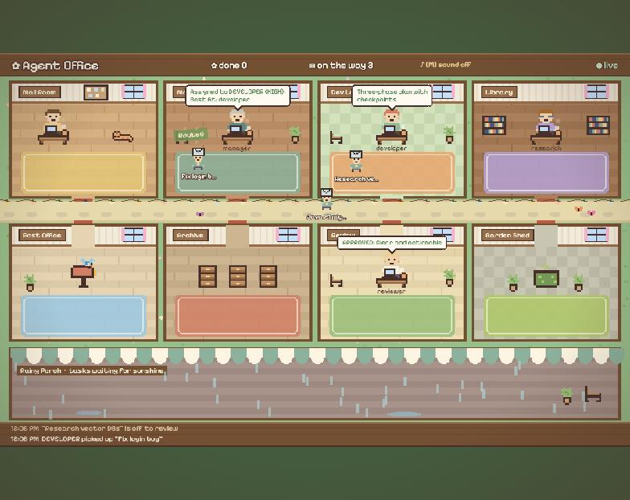

# Office view

A cozy 2D pixel-art village where every task is a courier carrying a letter between the agents' cottages while it happens. It is for watching and demos: it reads, it never changes anything.



## Running it

```bash
scripts/start.sh --office      # whole stack plus the office on http://localhost:5173
```

Or on its own, with the core already running:

```bash
cd office-ui && npm install && npm run dev
```

The Vite dev server proxies `/api` to the core (`AGENT_OFFICE_URL`, or `http://localhost:$AGENT_OFFICE_PORT`) and adds the `X-Api-Key` header from the project's `.env`, so the key never reaches the browser. Click the sound label or press `M` for soft music-box sounds. The light follows your clock (golden hour, lamps at night); add `?hour=22` to the URL to preview another time of day.

## How it works

```
TaskPipeline ─► TaskEventRecorder ─► TaskEventRecorded ─┬─ Trello, n8n, metrics
                                                         └─ OfficeStreamBroadcaster ─SSE─► office-ui
```

- **Core** — `OfficeStreamBroadcaster` is one more listener on committed audit events ([ADR 007](adr/007-integrations-react-to-committed-events.md)). `GET /api/v1/office/stream` returns server-sent events, one JSON message per event (`taskId`, `type`, `agent`, `details` cut to 200 characters). A comment every 15 seconds keeps proxies from closing idle streams. Disable it with `OFFICE_STREAM_ENABLED=false`.
- **Snapshot** — on every (re)connect the page lists unfinished tasks with `GET /api/v1/tasks` and puts them in the room their status says; tasks that finished while it was offline leave the floor.
- **Choreography** — `office-ui/src/choreographer.ts` turns each event into animation steps and remembers where every task is, so a courier only walks when the task changes rooms. Steps run in a queue per task: two tasks move at the same time, while one task's burst of events plays in order. A courier with a long backlog runs faster to catch up.

| Event | On screen |
|---|---|
| `TASK_CREATED` | A courier appears in the mail room; the envelope is light blue for Telegram, mint for Trello |
| `EXECUTION_STARTED` | The courier walks to that agent's room, the agent types with a "model thinking..." bubble |
| `EXECUTION_COMPLETED` / `EXECUTION_FAILED` | Summary bubble and sparkles / a puff, a sweat drop and the error code |
| `TASK_ASSIGNED`, `REVIEW_APPROVED`, `CHANGES_REQUESTED` | Routed, Approved! or Needs changes badge |
| `HUMAN_APPROVAL_REQUESTED` | A bell rings over the task |
| `TASK_BLOCKED` / `TASK_RESUMED` | A rain cloud passes and it waits on the Rainy Porch / it comes back to the mail room |
| `TASK_COMPLETED` | Filed in the archive drawers with a chime, `done` goes up |
| `TASK_FAILED`, `TASK_CANCELLED` | Goes to the compost bin in the garden shed |
| `USER_NOTIFIED` | A bluebird flies off to Telegram |
| `TRELLO_UPDATED` / `TRELLO_SYNC_FAILED` | The corkboard blinks green / red |

Around that, the village just lives: a cat naps in the mail room, mugs steam, butterflies cross the path and it never stops drizzling on the porch. All sprites are drawn in code as text grids (`office-ui/src/pixels.ts`) and sounds are WebAudio tones, so there are no image or audio files to license.

## Tests

```bash
cd office-ui && npm test          # choreography and queues
./mvnw verify                     # includes OfficeStreamBroadcasterTest and OfficeStreamIT
```
